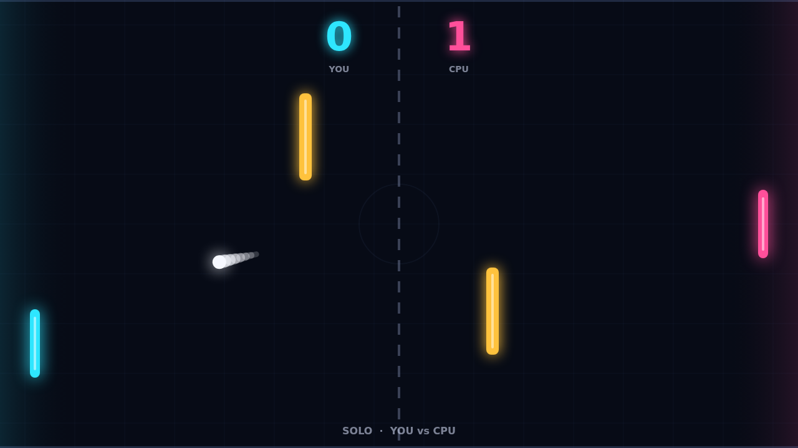
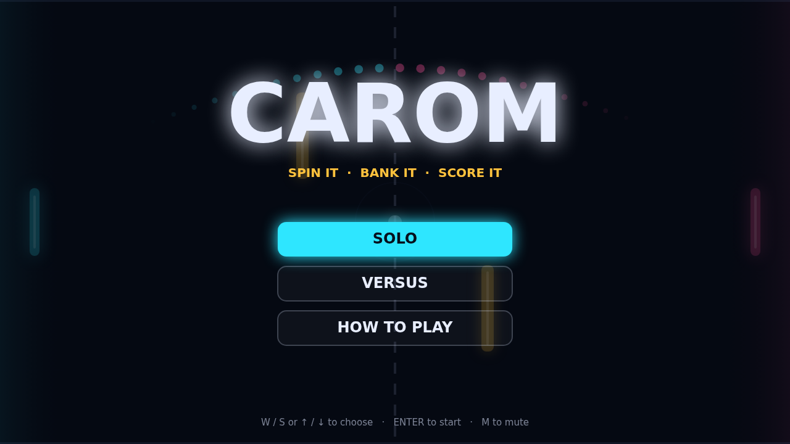

# Carom

Carom is a top-down paddle duel with a twist in the air. Two glowing paddles
face off across a dark field, a white ball ricochets between them, and two
amber bars stand guard in the middle of the court. Get the ball past the far
paddle to score; first to eleven wins, but you have to win by two.

Every point opens with a beat of calm: the ball waits at center court while a
ring closes around it, then it leaves toward whoever was just scored on. The
early exchanges are gentle and readable. Each return speeds the ball up a
little, so a long rally tightens into a sprint, and by match point the ball is
crossing the court in well under a second.

The heart of Carom is spin. Move your paddle as you strike and the ball bends
in flight the way you swung: sweep down and it hooks clockwise, sweep up and it
curls the other way, the curve fading as the shot travels. A flat block sends a
straight, honest return; a late, hard swing sends a banana shot that drifts
away from a paddle that thought it had the angle covered. Where the ball meets
your paddle matters too, with edge hits sending it out at steep angles.

The obstacles turn the open court into a bank-shot puzzle. Curl a ball off the
top wall and into the face of a bar and it comes back at an angle nobody
planned for, or thread it through the gap between the two for a clean winner.
Play Solo against a quick, sharp-eyed CPU, or hand a friend the arrow keys and
settle it in Versus on one keyboard.

